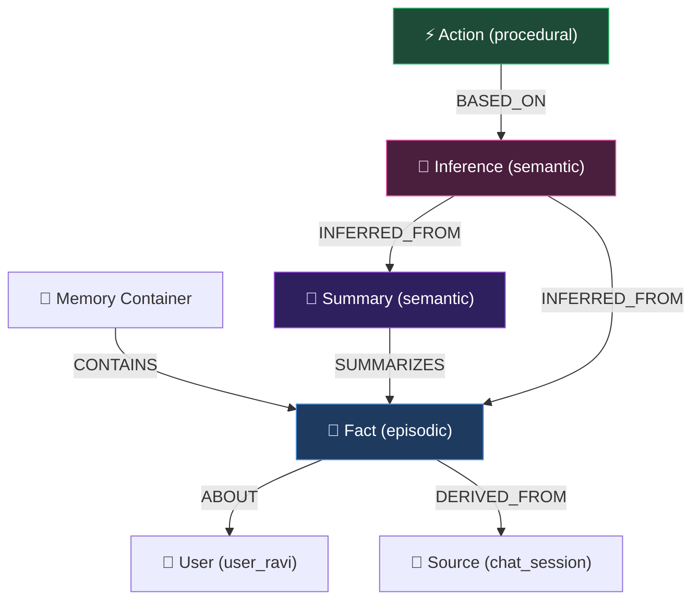
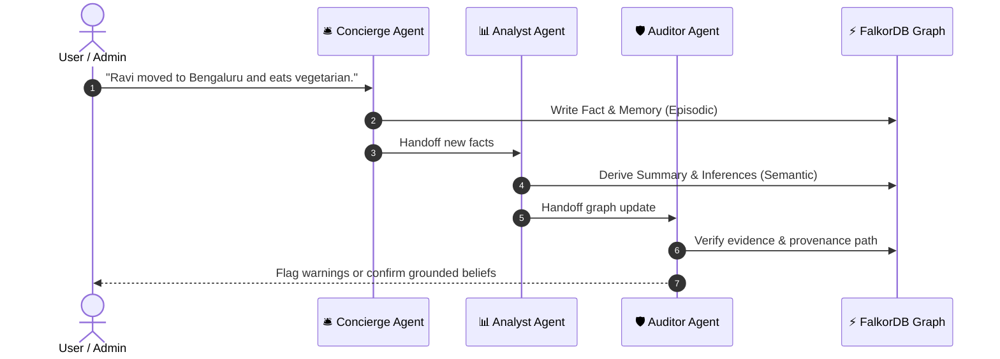

# 🕳️ Oo-blee-ET

<div align="center">

[](https://www.python.org/)
[](https://fastapi.tiangolo.com)
[](https://www.falkordb.com/)
[](https://react.dev/)
[](https://www.typescriptlang.org/)
[](https://modelcontextprotocol.io/)
[](https://ai.google.dev/)
[](LICENSE)

**Multi-Agent Memory as a Provenance Graph in FalkorDB: Explainable Context, Blast-Radius Previews, and Cryptographically Auditable Data Erasure.**

> *“**ou·bli·ette** (noun) — `/uː.bliˈɛt/` [French, from oublier ‘to forget’]*  
> *Historically, a subterranean dungeon entered only through a trapdoor at the top. In modern AI architectures, **Oo-blee-ET** is the chamber where agent beliefs, inferences, and memories are surgically traced and forgotten forever.*

[Key Features](#-key-features) • [Architecture](#-architecture) • [Quickstart](#-quickstart) • [UI Walkthrough](#-interactive-ui-walkthrough) • [CLI Usage](#-cli-agent-workflow) • [Testing](#-test-suite)

</div>

---

## 💡 The Problem: The Vector Store Amnesia Paradox

When autonomous agents interact with users over time, they don't merely store raw conversation transcripts—they distill **Facts**, synthesize **Summaries**, form **Inferences**, and trigger **Actions**:

```
User Statement  ──►  Episodic Fact  ──►  Semantic Summary  ──►  Inference  ──►  Autonomous Action
```

When a user exercises their **GDPR / CCPA "Right to be Forgotten"**, standard RAG vector databases face a fatal limitation:
* **Vector databases lose causal lineage.** Deleting the raw text embedding leaves downstream summaries, inferences, and scheduled tasks completely orphaned.
* **Derived beliefs continue to leak private information** across agents and even across multi-tenant boundaries.

**Oo-blee-ET solves this** by modeling all agent memories, reasoning chains, and cross-tier beliefs as a strict **Provenance Graph** inside [FalkorDB](https://www.falkordb.com). When a user requests deletion, Oo-blee-ET calculates the complete **blast radius**, previews the cascade, and performs an atomic, verifiable purge.

---

## ⚡ Key Features

* 🕸️ **Causal Provenance Tracking:** Every belief node (`Fact`, `Summary`, `Inference`, `Action`) preserves explicit causal edges (`DERIVED_FROM`, `SUMMARIZES`, `INFERRED_FROM`, `BASED_ON`, `ABOUT`).
* 💥 **Surgical Blast-Radius Erasure:** Two-phase deletion lifecycle:
  1. **Dry-Run Preview:** Identifies every dependent node, calculates shared derivations, and issues an SHA-256 preview hash.
  2. **Atomic Execution:** Validates the preview version token, deletes the subgraph within an atomic Cypher transaction, and preserves non-derived parent sources.
* 🧾 **Tamper-Evident Deletion Receipts:** Automatically writes verifiable JSON receipts (`receipts/<job_id>.json`) detailing the operator identity, reason, timestamps, Cypher queries, and list of purged node IDs.
* 🛡️ **Cross-Tenant Leakage Detection:** Scans for unauthorized cross-tenant copies (`LEAKED_INTO`) and foreign provenance references across isolated tenant graphs (`tenant_acme`, `tenant_globex`).
* 🤖 **Role-Based MCP Architecture:** Powered by the official [Model Context Protocol (MCP)](https://modelcontextprotocol.io/) Python SDK. Each agent process operates under strict least-privilege capability boundaries.
* 🌐 **Interactive Graph Explorer:** High-performance Cytoscape.js interface with dark/light themes, live Cypher query inspect logs, and real-time provenance path highlighting.
* 🍃 **Zero-Docker Low RAM Mode:** Designed to run smoothly even on 4 GB RAM laptops by connecting directly to the **FalkorDB Cloud Free Tier** with zero local Docker overhead.

---

## 🏛️ Architecture

### 1. Provenance Graph Model



### 2. Multi-Agent Ecosystem



---

## 🚀 Quickstart

You can run Oo-blee-ET either using **FalkorDB Cloud** (zero local RAM overhead, ideal for laptops) or **Local Docker**.

### Prerequisites
* Python 3.11+
* Node.js 18+
* (Optional) Docker Desktop or a free [FalkorDB Cloud](https://app.falkordb.cloud) database.

---

### Step 1: Clone and Configure Environment

```bash
git clone https://github.com/appongaier/Oo-blee-ET.git
cd Oo-blee-ET/oo-blee-ET
copy .env.example .env
```

Edit your `.env` file:
```env
# --- Option A: FalkorDB Cloud (Free Tier, 0 RAM overhead) ---
FALKORDB_HOST=your-instance.cloud.falkordb.com
FALKORDB_PORT=your_port
FALKORDB_USERNAME=falkordb
FALKORDB_PASSWORD=your_password

# --- Option B: Local Docker ---
# FALKORDB_HOST=localhost
# FALKORDB_PORT=6379

# --- AI Agents (Optional) ---
GEMINI_API_KEY=your_gemini_api_key_here
LLM_MODEL=gemini-2.5-flash
```

> If using Docker, run `docker compose up -d` now.

---

### Step 2: Initialize Backend & Seed Database

```bash
cd backend
py -3 -m venv .venv
.venv\Scripts\activate
pip install -r requirements.txt

# Seed the initial benchmark graphs (Acme and Globex tenants)
python ..\data\seed.py --reset
```

---

### Step 3: Run the Application

You can start the backend and frontend together:

#### Option A: Unified Server (FastAPI serves both API and React UI)
```bash
# Build the UI once from the frontend directory:
cd ..\frontend
npm install
npm run build

# Start FastAPI (serves both API & Frontend on port 8000):
cd ..\backend
uvicorn app.main:app --port 8000
```
Open **[http://localhost:8000](http://localhost:8000)** in your browser!

#### Option B: Independent Dev Servers (Hot Reloading)
* **Terminal 1 (Backend):**
  ```bash
  cd backend
  .venv\Scripts\activate
  uvicorn app.main:app --reload --port 8000
  ```
* **Terminal 2 (Frontend):**
  ```bash
  cd frontend
  npm install
  npm run dev
  ```
Open **[http://localhost:5173](http://localhost:5173)** in your browser!

---

## 🖥️ Interactive UI Walkthrough

| Tab | Purpose & Capabilities |
|---|---|
| **🔍 Inspect** | Click on any node (`Fact`, `Summary`, `Inference`, `Action`) to visually inspect its upstream parents and downstream consequences. Inspect exact parameterized Cypher queries in real time. |
| **💾 Memory** | Act as the Concierge agent! Enter arbitrary statements for any user. Watch the system dynamically synthesize a `Fact`, `Source`, and `Memory` node on the live graph. |
| **💥 Erase** | Perform GDPR-compliant erasures. Select a data subject (`Ravi`), run a dry-run blast-radius calculation, review affected dependent summaries/inferences, and execute atomic erasure. |
| **🤖 Agents** | Multi-agent autonomous pipeline powered by Gemini or Claude. Ask the Auditor: *"Why does sum_team_q4 exist?"* to see grounded graph traversal and hallucination checks. |
| **📜 Queries** | Live rolling telemetry stream of the last 60 Cypher queries executed against FalkorDB, complete with execution durations and parameter maps. |

---

## 💻 CLI Agent Workflow

You can interact with the multi-agent system directly from your terminal:

```bash
cd backend
.venv\Scripts\activate

# 1. Ask the Auditor agent to explain a belief's provenance
python -m app.agents.cli ask auditor "Why does sum_team_q4 exist?"

# 2. Run the full Concierge -> Analyst -> Auditor ingestion pipeline
python -m app.agents.cli pipeline -s "Ravi plays chess on weekends." -s "Ravi prefers window seats on flights."

# 3. Interactive erasure workflow (dry-run preview + confirmation prompt)
python -m app.agents.cli erase --user user_ravi
```

---

## 🧪 Test Suite

The project includes a robust test suite covering graph schema consistency, MCP protocol servers, and end-to-end erasure integrity.

```bash
# 1. Run Frontend Vitest Suite (28 tests)
cd frontend
npm test

# 2. Run Offline Backend Unit Tests (38 tests)
cd ..\backend
pytest -k "not live"

# 3. Run Full Live Integration Suite (182 tests with FalkorDB & MCP)
pytest
```

---

## 📂 Repository Layout

```
oo-blee-ET/
├── backend/
│   ├── app/
│   │   ├── agents/          # Multi-agent orchestrator, LLM adapters (Gemini/Claude), CLI
│   │   ├── tools/           # 11 core graph tools (remember, forget, infer, summarize, audit)
│   │   ├── api.py           # FastAPI endpoints for graph visualization, memory, and erasure
│   │   ├── config.py        # Pydantic environment configuration
│   │   ├── db.py            # FalkorDB client factory & health checks
│   │   ├── lifecycle.py     # MCP runtime process manager & tool routers
│   │   ├── schema.py        # Strict Cypher label allowlists & relationship patterns
│   │   └── seed.py          # Synthetic benchmark generator for tenant graphs
│   └── tests/               # 182 unit and live integration tests
├── frontend/
│   ├── src/                 # React 18 + TypeScript + Cytoscape.js application
│   │   ├── AgentsPanel.tsx  # Natural language Q&A and pipeline inspector
│   │   ├── ErasePanel.tsx   # Blast-radius preview & confirm panel
│   │   ├── GraphView.tsx    # Cytoscape graph canvas with force layout
│   │   ├── InspectPanel.tsx # Node details, provenance ancestry, and cypher views
│   │   └── MemoryPanel.tsx  # Dynamic episodic memory ingestion
├── mcp/
│   └── server.py            # Official Model Context Protocol (MCP) stdio server
├── data/
│   ├── graph-model.md       # Comprehensive graph specifications & schema rules
│   ├── queries.cypher       # Exploration & audit Cypher scripts
│   └── seed.py              # CLI seed utility
└── docker-compose.yml       # Local FalkorDB container configuration
```

---

## ⚖️ Legal & Compliance Notice

> **Disclaimer:** This software is a technical demonstration of provenance-graph-based data erasure algorithms and multi-agent memory tracking. It does not constitute legal counsel, formal privacy audit certification, or an automated guarantee of complete statutory compliance under GDPR, CCPA, or HIPAA. All benchmark seed data is completely synthetic and contains no actual personal identifiable information (PII).

---

<div align="center">
Made with 🕳️ by <b>Oo-blee-ET</b>
</div>
